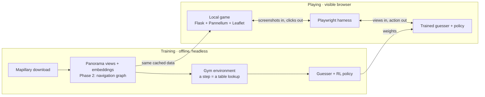

# GeoGuessr RL Agent — Project Plan

**Lead:** Daniel Hu · **Last updated:** 2026-11-04 · **Status:** Phase 1 kickoff

## 1. Goal

Build an agent that plays a GeoGuessr-style game in a real browser on our laptops. It looks around (and later moves through) street-level panoramas, then drops a pin on a world map.

The project runs in two phases:

| Phase | When | Outcome |
|---|---|---|
| **Phase 1** | Nov 5 – Dec 4, 2026 (fall quarter) | A complete agent that guesses from one or several views of a single panorama and plays our local game end-to-end through a visible Playwright harness. |
| **Phase 2** | Jan 4 – Mar 12, 2027 (winter quarter) | Navigation: an RL policy that decides where to look, where to move, and when to stop and guess. |

## 2. Confirmed decisions

- **Data:** Mapillary (free, CC-BY-SA, includes 360° panoramas). Not Google Street View.
- **No geoguessr.com.** Automated play there risks account bans and is too slow for training. We build our own local game.
- **Model route:** a supervised geocell guesser first. RL is used only for navigation (deciding where to look and when to stop), where decisions are sequential.
- **Harness:** Playwright with a visible browser window in Phase 1. OS-level control (`mss` + `pyautogui`) is a Phase 2 stretch.
- **Models:** three in total. A pretrained StreetCLIP encoder (frozen) turns views into embeddings; a geocell classifier (trained in Phase 1, then frozen) turns embeddings into a location belief and the final guess; a navigation policy (Phase 2, trained with PPO) decides where to look and when to guess. No model is trained from scratch, and no VLM fine-tuning.
- **Compute:** laptops. A cloud GPU only if the one-time embedding pass is too slow.

## 3. Ground rules

1. **The model sees pixels only.** The harness may read game state from the page for scoring and logging, but never passes it to the model.
2. **Train/test splits are by region and by creator, never by image.** One contributor's camera (hood, mount, tint) must not appear in both train and test.
3. **No data or model weights in git.** Store them on the shared drive or Hugging Face Hub; configs record the paths.
4. **Credit Mapillary** (CC-BY-SA) in the game footer and in any write-up.

## 4. Architecture



Training never touches the browser. The browser is for playing, evaluating, and demoing. Both sides share one cached dataset and the same interfaces in `core/`, so a model trained offline plugs into the harness unchanged.

## 5. Repo layout

```
geoguessr-rl/
├── core/                 # interfaces, schemas, view spec, scoring, metrics
├── data/                 # Mapillary sampler, downloader, filters, splits
├── env/                  # view crops, embeddings; Phase 2 graph + Gym env
├── models/
│   ├── guesser/          # geocells, classifier, multi-view, expected-score guess
│   └── policy/           # Phase 2 baselines + PPO
├── game/                 # Flask backend + Pannellum/Leaflet frontend
├── harness/              # Playwright harness
├── scripts/              # one entry script per task, plus run_e2e.py
├── tests/fixtures/       # ~50 sample panoramas + manifest everyone tests against
├── configs/              # one config file per module, never one shared file
├── pyproject.toml        # Python 3.11, managed with uv
└── PLAN.md
```

## 6. Contracts (`core/`, written at kickoff, changed only via reviewed PR)

Every module codes against these, not against other modules' code.

### 6.1 Data formats

**`images.parquet`**, one row per Mapillary image:

| Column | Type | Notes |
|---|---|---|
| `image_id` | str | Mapillary id |
| `sequence_id` | str | Capture it belongs to |
| `creator_id` | str | Used for leakage-safe splitting |
| `lat`, `lon` | float | From `computed_geometry`, falling back to `geometry` |
| `captured_at` | int | Unix ms |
| `is_pano` | bool | 360° panorama or flat |
| `compass_angle` | float | Degrees |
| `quality_score` | float | For filtering |
| `region_id` | str | Episode region it was sampled from |
| `split` | str | `train` / `val` / `test` |
| `path` | str | Relative path to the image file |

**`views.parquet` + `embeddings.npy`:** one row per (panorama, heading). Columns are `view_id`, `image_id`, `heading_deg`, and `row` (the index into `embeddings.npy`). `embeddings.npy` has shape `(n_views, D)` in float16.

**Phase 2 `edges.parquet`:** columns `src`, `dst`, `kind` (`seq` or `spatial`), `bearing_deg`, `dist_m`.

### 6.2 View spec (shared by training and the game)

Training crops and the game's rendered view **must match**, or the model sees images unlike its training data.

- 8 headings at 45° steps, pitch 0°, horizontal field of view 90°.
- Square output, same pixel size in both places (e.g. 336 × 336; fixed at kickoff).
- One canonical function in `core/` cuts a perspective view from a panorama and converts headings (Mapillary's `compass_angle` gives the compass direction of the panorama's centre).
- The game's `#pano` element renders at exactly this FOV and aspect ratio, and the harness screenshots only that element.

### 6.3 Python interfaces

```python
class Encoder(Protocol):
    def embed(self, images: list[np.ndarray]) -> np.ndarray: ...   # (n, D)

class Guesser(Protocol):
    def cell_probs(self, view_embs: np.ndarray) -> np.ndarray: ...  # (K,), combines all views
    def guess(self, probs: np.ndarray) -> tuple[float, float]: ...  # (lat, lon)

class Policy(Protocol):                                             # Phase 2
    def act(self, obs: Observation) -> Action: ...                  # TURN_L, TURN_R, FORWARD, BACK, GUESS
```

The Phase 2 environment follows the Gymnasium API (`reset(seed) -> obs, info`; `step(action) -> obs, reward, terminated, truncated, info`).

### 6.4 Game API and page elements

- `GET /api/round/new` → `{round_id, pano_url, heading}`
- `POST /api/round/{id}/guess` with `{lat, lon}` → `{distance_km, score, true_lat, true_lon}`
- Phase 2: `GET /api/node/{id}/neighbors` → list of `{node_id, bearing_deg}`
- Page element ids: `#pano`, `#map`, `#submit`, `#next-round`. `window.__game` exposes state **for logging only** (see ground rule 1).

### 6.5 Scoring and metrics (`core/scoring.py`, `core/metrics.py`)

Great-circle distance by the haversine formula, with $R = 6371$ km:

$$
d = 2R \arcsin\sqrt{\sin^2\!\left(\tfrac{\phi_2-\phi_1}{2}\right) + \cos\phi_1\cos\phi_2\,\sin^2\!\left(\tfrac{\lambda_2-\lambda_1}{2}\right)}
$$

Score (community approximation of GeoGuessr's world map):

$$
S(d) = 5000\, e^{-d/1492.7}
$$

Reported metrics: median error (km), mean score, and the share of guesses within 1 / 25 / 200 / 750 / 2500 km, overall and per continent.

## 7. Technical approach

### 7.1 Data

- Sample about 500 episode regions worldwide, balanced by country, using Mapillary's coverage vector tiles (filter on `is_pano`). Fetch image details through the entity API.
- Drop low-quality captures using `quality_score`. Cap images per sequence.
- Use panoramas for the game and navigation. Flat images are extra training data for the single-view guesser only.
- **Save `sequence_id` and positions from day one** so Phase 2 can build the navigation graph without re-downloading.

### 7.2 Guesser

1. Run a frozen encoder (CLIP or SigLIP) over every view once; store embeddings.
2. Cluster training locations into geocells $k = 1,\dots,K$ with centroids $c_k$. Train a small classifier for $p(k \mid v)$.
3. **Combine views.** Treat each view $v_i$ as independent evidence: each view adds its log-probability "vote", and the prior is subtracted so it isn't counted $t$ times:

$$
\log p(k \mid v_{1:t}) = \sum_{i=1}^{t} \log p(k \mid v_i) - (t-1)\log p(k) + \text{const}
$$

4. **Guess by expected score**, not the most likely cell. When the model is split between two distant regions, a point between them can score higher:

$$
\hat a = \arg\max_{a} \sum_{k=1}^{K} p_k \, S\big(d(a, c_k)\big)
$$

### 7.3 Navigation (Phase 2)

- **Graph.** Nodes are panoramas. Edges are sequence edges (consecutive images in one capture) and spatial edges (images from different sequences within about 10–15 m, found with a KD-tree).
- **Environment.** Precomputed view embeddings make every step a table lookup, so RL trains on a laptop CPU.
- **Actions:** turn left 45°, turn right 45°, move forward (to the neighbor whose bearing is closest to the current heading), move back, guess. The neighbor-selection rule lives in `core/` so the env and the game pick the same neighbor.
- **Reward:** final score minus a step cost $c$, where $T$ is the number of steps taken:

$$
R = S(d_T) - c\,T
$$

- **Optional denser reward:** potential-based shaping with $\Phi$ = the guesser's expected score. It gives a signal every step without changing which policy is optimal:

$$
r_t = \Phi(s_{t+1}) - \Phi(s_t)
$$

- **Policy:** a small GRU or transformer over the views seen so far, trained with PPO (CleanRL or Stable-Baselines3). The guess itself always comes from the supervised guesser.
- **The policy is a separate model on top of the other two.** StreetCLIP and the geocell classifier stay frozen while PPO trains the policy; the policy only chooses what to look at and when to stop.

### 7.4 Game

- Flask backend serving rounds, panoramas, and scoring from the cached dataset.
- Pannellum renders panoramas offline at the agreed view spec (6.2). Leaflet with OpenStreetMap tiles is the guess map.
- Optional debug panel: the model's top guesses as a heatmap. It is outside `#pano`, so the model never sees it.

### 7.5 Harness

- Playwright drives its own Chromium window. Observe: screenshot `#pano`. Act: drag to rotate, click the map, click `#submit`. Phase 2: click movement arrows.
- **Watchable by default:** `headless=False`, `slow_mo` (about 300 ms) so actions are visible, and an injected cursor dot that follows the agent's mouse events.
- **Recording:** Playwright video recording for every evaluation session (this produces the M4 demo video), plus trace files for debugging.
- **Headless mode** for fast bulk evaluation.
- Map clicks use Leaflet's own conversion (`map.latLngToContainerPoint`) to turn a predicted $(\phi, \lambda)$ into page pixels.

## 8. Phase 1 tasks (fall quarter)

Thanksgiving is Nov 26–27; finals start Dec 5. Phase 1 ends Fri Dec 4.

### M0 — Kickoff · Sun Nov 8

- [ ] Create the repo, `pyproject.toml` (uv, Python 3.11), pre-commit with `ruff`, `.gitignore` for data and weights
- [ ] Write the `core/` contracts (section 6), including the canonical view-cropping function
- [ ] Fix the view size and choose the encoder (CLIP or SigLIP)
- [ ] Build `tests/fixtures/` (~50 sample panoramas, manifest, fake embeddings)
- [ ] Placeholder version of every module that runs on the fixtures
- [ ] `scripts/run_e2e.py` chaining the placeholders; CI running `ruff`, `pytest`, and `run_e2e.py` on every PR
- [ ] GitHub milestones and issues for M0–M10
- **Done when:** everyone can run the full placeholder pipeline on the fixtures.

### M1 — Pilot · Sun Nov 15

- [ ] Downloader fetches ~50 pilot regions into `images.parquet`
- [ ] Crop + embed script runs on fixtures and pilot data
- [ ] Geocells + classifier train on pilot data
- [ ] Scoring and metrics modules with tests
- [ ] Game shows one round from fixtures (pan the panorama, click the map, see the score)
- [ ] Harness opens the game visibly, screenshots `#pano`, and clicks the map
- **Done when:** each piece demos on fixture or pilot data.

### M2 — Real data · Sun Nov 22

- [ ] ~500 regions downloaded with the region/creator split
- [ ] All views embedded
- [ ] Guesser v1 trained; single-view metrics reported
- [ ] Game serves rounds from real data
- [ ] Harness completes a full round (look around → guess → submit → next round) with a random guesser; video recording works
- [ ] Consistency check: a training crop and a harness screenshot of the same panorama and heading embed almost identically (cosine similarity above about 0.95)
- **Done when:** single-view numbers exist and the harness plays a full round.

### M3 — Integration · Sun Nov 29 (short week)

- [ ] Multi-view combining in the guesser
- [ ] Value-of-information test: single view vs 8-view look-around on the test split
- [ ] Harness plays with the real guesser
- [ ] Cursor overlay, slow motion, and headless batch mode polished
- [ ] `run_e2e.py` runs the full pipeline on fixtures
- [ ] Agree the navigation threshold for decision point G1
- **Done when:** the agent plays the local game end-to-end with the real model.

### M4 — Freeze and present · Fri Dec 4

- [ ] Evaluation report: metrics (6.5) over a few hundred harness rounds, single view vs look-around
- [ ] Demo video from the harness recordings
- [ ] **Decision point G1:** go/no-go on navigation (section 10)

### Cut list (in this order, if behind)

1. Drop flat images; panoramas only.
2. Fewer regions.
3. Harness submits the guess through JavaScript instead of clicking map pixels.
4. Skip the multi-view comparison.

### Over break (optional, low effort)

- [ ] Leave the downloader running to fetch the extra panoramas around each region that navigation needs.

## 9. Phase 2 tasks (winter quarter)

MLK Day (Jan 18) and Presidents' Day (Feb 15) fall in the M6 and M8 weeks.

### M5 — Navigation environment · Sun Jan 17

- [ ] Build the panorama graph (sequence + spatial edges)
- [ ] Gym environment with navigation actions, tested on fixtures
- [ ] Movement arrows in the game; harness clicks them

### M6 — Navigation baselines · Sun Jan 24

- [ ] Look-around and random-walk strategies evaluated in the env
- [ ] Harness runs the baseline strategies in the browser

### M7 — PPO policy · Sun Feb 14

- [ ] PPO trained; step cost and reward shaping tuned
- [ ] **Decision point G2** (section 10)
- [ ] (Stretch) OS-level control prototype

### M8 — End-to-end navigation · Sun Feb 21

- [ ] Policy exported in the `Policy` interface
- [ ] Policy plays in the visible harness; evaluation runs

### M9 — Stretch · Sun Mar 7

- [ ] Learned view pooling to replace the simple combining rule
- [ ] Games against humans
- [ ] OS-level harness polish

### M10 — Final report and demo · Fri Mar 12

- [ ] Final metrics
- [ ] Final demo video and write-up

## 10. Decision points

- **G1 · Dec 4: is navigation worth it?** Compare 8-view look-around with a single view. If the gain is below the threshold agreed at M3 (suggested starting point: at least 15% lower median error), keep Phase 2 navigation small and put more effort into the guesser (learned view pooling, distance-smoothed labels, more data).
- **G2 · Feb 14: is PPO working?** If PPO does not beat the fixed strategies from M6, write that up as a result and use M9 to revisit the reward and observation design.

## 11. Risks

| Risk | Mitigation |
|---|---|
| Contributor or near-duplicate leakage inflates results | Split by region and creator (ground rule 2) |
| Coverage bias (model always guesses dense countries) | Balance regions by country; cap images per sequence |
| Training crops differ from what the game renders | Shared view spec (6.2) and the M2 consistency check |
| Mapillary rate limits slow the bulk download | Check current limits before M1; cache everything; start the pilot early |
| Disk space on laptops | Store images at 1024 px; about 1.2 GB of embeddings per 100K panoramas; images on the shared drive |
| RL is finicky | Fixed-strategy baselines first; decision point G2 |
| Interface drift between modules | Contracts in `core/` change only by reviewed PR; weekly `run_e2e.py` check |

## 12. Working agreements

- **Branches:** short-lived feature branches, small PRs, at least one review.
- **Formatting:** `ruff` via pre-commit, so formatting never causes conflicts.
- **Dependencies:** `uv`; one person edits the lockfile. Request new packages in the PR description.
- **Configs:** one file per module in `configs/`; no shared global config.
- **Notebooks:** kept out of the repo, or paired with `.py` via jupytext.
- **Weekly sync** (day TBD): demo progress; run `run_e2e.py` on fixtures and fix anything that broke.

## 13. Compute and cost

| Item | Where | Cost |
|---|---|---|
| Downloading, guesser, PPO, game, harness | Laptops | $0 |
| One-time StreetCLIP embedding pass (~400K views) | Laptop overnight, or one Colab/cloud GPU session | $0–5 |
| Mapillary data | API | $0 |
| (Stretch) encoder fine-tuning | Cloud A100 | ~$20–50 |

To keep the embedding pass on laptops, cap panoramas per region for the guesser's training data. Check whether a UCLA Hoffman2 allocation is available through a lab before renting a GPU.

## 14. Open questions

- [ ] Who takes which tasks.
- [ ] Weekly sync day and time.
- [ ] Final view size (e.g. 336 × 336) and encoder choice (CLIP vs SigLIP), fixed at M0.
- [ ] Current Mapillary API rate limits for the bulk download.
- [ ] Shared storage location for data and weights (drive vs Hugging Face Hub).
- [ ] GPU access (Colab or Hoffman2) for the one-time embedding pass, if laptops are too slow.

## 15. References

- [Mapillary API documentation](https://www.mapillary.com/developer/api-documentation)
- PIGEON: Haas, Skreta, Alberti & Finn, *PIGEON: Predicting Image Geolocations* (CVPR 2024), the geocell + CLIP approach this guesser follows
- [Playwright for Python](https://playwright.dev/python/)
- [Pannellum](https://pannellum.org/) · [Leaflet](https://leafletjs.com/)
- [CleanRL](https://github.com/vwxyzjn/cleanrl) · [Stable-Baselines3](https://github.com/DLR-RM/stable-baselines3) · [Gymnasium](https://gymnasium.farama.org/)
